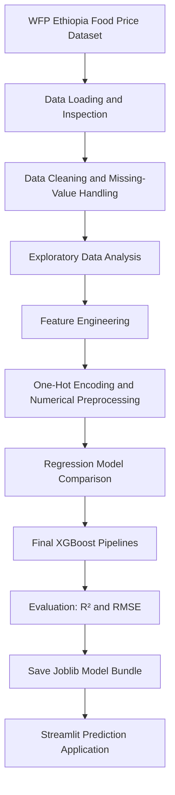

# Ethiopian Food Price Prediction & Market Analysis

**Project Type:** Machine Learning · Food Price Forecasting · Data Analytics  
**Purpose:** Analyze historical food prices in Ethiopia and predict both local market prices in Ethiopian Birr (ETB) and equivalent prices in US dollars (USD) using an XGBoost regression model.  
**Primary Model:** XGBoost Regressor with One-Hot Encoding  
**Application:** Streamlit  
**Dataset:** World Food Programme (WFP) Ethiopia Food Prices dataset

---

## 1. Problem and Solution

Food prices can vary across markets, administrative regions, commodities, and time. Understanding these variations is important for market monitoring, planning, and decision-making.

This project uses historical food-price observations from Ethiopia to explore market patterns and build machine-learning models that estimate two price targets.

### What the System Does

1. **Loads and examines the data:** Reads the Ethiopia food-price dataset and inspects its structure, variables, missing values, and duplicate records.
2. **Cleans the data:** Removes the HXL metadata row, converts date and price fields to appropriate types, and handles missing administrative and geographical values.
3. **Explores market patterns:** Examines price trends over time, regional price distributions, commodity prices, seasonal patterns, and geographical price variation.
4. **Creates model features:** Uses administrative, market, commodity, unit, price-status, price-type, location, and date-related information.
5. **Trains regression models:** Compares five regression algorithms and develops separate XGBoost pipelines for the two price targets.
6. **Evaluates performance:** Measures model performance using training and testing R², testing RMSE, and the train-test R² gap.
7. **Supports predictions:** Saves fitted preprocessing and model pipelines for use by the prediction application.

---

## 2. Project Objectives

- Analyze historical food-price patterns across Ethiopian markets.
- Explore differences in prices among administrative regions and commodities.
- Examine annual trends and monthly seasonal patterns.
- Visualize the geographical distribution and intensity of food prices.
- Build predictive models for `price` and `usdprice`.
- Compare different regression algorithms and evaluate their predictive performance.
- Provide a basis for interactive food-price analysis and prediction.

---

## 3. Dataset Description

The notebook loads the dataset from:

```text
wfp_food_prices_et.xlsx
```

The dataset contains **36,747 rows and 14 columns** before the HXL metadata row is removed. After removing that metadata row, the notebook reports **36,746 food-price observations**.

### Main Dataset Variables

| Variable | Description |
|---|---|
| `date` | Date of the food-price observation |
| `admin1` | First-level administrative region |
| `admin2` | Second-level administrative area |
| `market` | Market name |
| `latitude` | Market latitude |
| `longitude` | Market longitude |
| `category` | Food category |
| `commodity` | Commodity name |
| `unit` | Measurement unit |
| `priceflag` | Price observation status or flag |
| `pricetype` | Price type, such as Retail |
| `currency` | Currency of the recorded price |
| `price` | Food price in the local currency (ETB in this dataset) |
| `usdprice` | Food price expressed in US dollars |

### Data Quality Checks

The notebook checks missing values and duplicate records. It reports five missing values in each of `admin1`, `admin2`, `latitude`, and `longitude`, and no duplicated rows.

The notebook handles missing coordinates through a sequence of market-level, `admin2`-level, `admin1`-level, and global-median fallbacks. Missing administrative labels are filled using the column mode.

---

## 4. Data Preparation and Feature Engineering

The project applies several data preparation steps before model training:

- Removes the first HXL metadata row.
- Converts `date` to a datetime variable.
- Converts `price` and `usdprice` to numeric values.
- Imputes missing geographical coordinates using progressively broader group-level fallbacks.
- Fills missing `admin1` and `admin2` values using their most frequent values.
- Applies interquartile-range (IQR) capping to selected numeric variables to limit the influence of extreme observations.
- Sorts observations by market, commodity, and date during feature engineering.
- Extracts `year` and `month` from the date.
- Creates cyclical month features, `month_sin` and `month_cos`, to represent seasonal patterns.

### Model Input Features

The final two-target XGBoost pipeline uses the following feature groups.

**Categorical features:**
- `admin1`
- `admin2`
- `market`
- `category`
- `commodity`
- `unit`
- `priceflag`
- `pricetype`

**Numerical features:**
- `latitude`
- `longitude`
- `year`
- `month`
- `month_sin`
- `month_cos`

The target columns are `price` and `usdprice`. The `currency` field is excluded from the model features because it is constant in the dataset used.

### Preprocessing

The final pipeline applies:

- **One-Hot Encoding** to categorical variables, using `handle_unknown='ignore'` so that previously unseen categories can be handled during prediction.
- **Standard scaling** to numerical location features in the preprocessing workflow.
- Date-derived numerical features for the model input.

The preprocessing steps are fitted as part of each target's model pipeline so the same transformations can be applied to new observations.

---

## 5. Exploratory Data Analysis

The notebook includes visual and statistical analysis of food prices.

### Main Analyses

1. **Average Food Price Trends:** Examines average food prices over time.
2. **Price Distribution by Region:** Uses box plots to compare price distributions across `admin1` regions.
3. **Commodity Price Comparison:** Identifies commodities with the highest average prices.
4. **Annual Price Trend and Growth:** Examines annual average prices and year-over-year percentage growth.
5. **Monthly Seasonality:** Compares average prices across the twelve months.
6. **Geospatial Market Price Map:** Displays market locations and price intensity using latitude and longitude.
7. **Historical Staple Price Trends:** Compares monthly average prices for Maize (white), Wheat, Sorghum, Rice, and Teff.
8. **Feature Correlation:** Uses correlation heatmaps to examine relationships among engineered numerical features.

These analyses help describe historical market behaviour; they do not by themselves establish the causes of price changes.

---

## 6. Model Development

### 6.1 Model Comparison

The notebook compares five regression algorithms using One-Hot Encoded features:

- Ridge Regression
- LightGBM
- XGBoost
- CatBoost
- Optimized Random Forest

The comparison uses training R², testing R², testing RMSE, and the difference between training and testing R².

### 6.2 Final Prediction Approach

The final approach uses **two separate XGBoost regression pipelines**:

- `price`: predicts the local food price in ETB.
- `usdprice`: predicts the food price in USD.

Each pipeline combines categorical and numerical preprocessing with an XGBoost regressor. The notebook uses an 80/20 train-test split with `random_state=42`.

### 6.3 Reported XGBoost Results

The notebook reports the following results for the final regularized XGBoost pipelines:

| Target | Training R² | Testing R² | Testing RMSE | Overfit Gap |
|---|---:|---:|---:|---:|
| `price` (ETB) | 0.9632 | 0.9604 | 371.2434 | 0.0028 |
| `usdprice` (USD) | 0.9517 | 0.9499 | 9.6631 | 0.0018 |

**Interpretation:** The reported testing R² values indicate that the fitted models explain a substantial proportion of the variation in the held-out test data. The small reported train-test R² gaps indicate similar training and testing R² scores in this evaluation.

RMSE is expressed in the units of the target: ETB for `price` and USD for `usdprice`. These are notebook-reported evaluation results and should not be interpreted as a guarantee of future prediction accuracy.

---

## 7. Model Saving and Application

The notebook saves the fitted preprocessing and XGBoost pipelines, together with model metrics and feature/target metadata, in a serialized Joblib model bundle.

The notebook shows the final model artifact being saved as:

```text
XG_Boost.joblib
```

An earlier model-bundle save cell also uses:

```text
random_forest_model.joblib
```

Use the filename that matches the artifact generated in your final training run and the filename expected by the Streamlit application.

The Streamlit application code in the notebook is named:

```text
app.py
```

The application is intended to load the saved model bundle and use the fitted pipelines for prediction. Keep the model artifact and the dataset in the locations expected by the application code.

---

## 8. Technology Stack

| Technology | Purpose |
|---|---|
| Python | Main programming language |
| Pandas | Data loading, cleaning, and manipulation |
| NumPy | Numerical and feature calculations |
| Matplotlib | Data visualization |
| Seaborn | Statistical visualization |
| Plotly | Interactive charts and geographical visualizations |
| Scikit-learn | Preprocessing, pipelines, data splitting, and evaluation |
| XGBoost | Final regression models |
| LightGBM | Model comparison |
| CatBoost | Model comparison |
| Joblib | Saving and loading trained model pipelines |
| Streamlit | Interactive application interface |
| OpenPyXL | Reading Excel workbooks with Pandas |

---

## 9. Setup and Installation

### Prerequisites

- Python 3.10 or later is recommended.
- The project dataset: `wfp_food_prices_et.xlsx`.
- The trained model bundle generated by the notebook.
- The project source files, including `app.py` if you want to run the Streamlit application.

### 1. Clone the Repository

```bash
git clone https://github.com/mengistughiwot602-code/Ethiopian_Food_Price_Prediction_with_XG.git
cd your-repository
```

### 2. Create a Virtual Environment

```bash
python -m venv .venv
```

Activate it:

**Windows (PowerShell):**
```bash
.venv\Scripts\Activate.ps1
```

**Windows (Git Bash):**
```bash
source .venv/Scripts/activate
```

**Linux / macOS:**
```bash
source .venv/bin/activate
```

### 3. Install Dependencies

```bash
pip install pandas numpy matplotlib seaborn plotly scikit-learn xgboost lightgbm catboost joblib streamlit openpyxl
```

If the repository contains a `requirements.txt` file, you can instead install the listed dependencies with:

```bash
pip install -r requirements.txt
```

### 4. Place the Required Files

Make sure the dataset, model bundle, and application file are available at the paths expected by the notebook or application.

Example layout:

```text
project/
│
├── app.py
├── wfp_food_prices_et.xlsx
├── XG_Boost.joblib
├── README.md
└── requirements.txt
```

This is an example layout. Adjust filenames and locations to match the actual files in your repository and the paths used in `app.py`.

---

## 10. Running the Project

### Run the Notebook

Open the notebook in Google Colab or Jupyter Notebook. Make sure the Excel dataset is available at the path used in the data-loading cell, then run the cells in order.

The notebook performs data inspection, cleaning, exploratory analysis, feature engineering, model comparison, final XGBoost training, evaluation, and model saving.

### Run the Streamlit Application

From the project directory, with the virtual environment activated:

```bash
streamlit run app.py
```

Streamlit will display a local URL in the terminal. Open that URL in a web browser to use the application.

---

## 11. Project Workflow



---

## 12. Limitations and Considerations

- Predictions depend on the quality, coverage, and historical patterns of the dataset.
- The reported metrics describe the test split used in the notebook; performance may differ on new markets, commodities, or later periods.
- The notebook uses a random train-test split. For forecasting future periods, a chronological evaluation should also be considered.
- One-Hot Encoding can handle unseen categorical values through `handle_unknown='ignore'`, but predictions for unfamiliar categories may be less reliable.
- IQR capping changes extreme values and should be considered when interpreting price distributions and model results.
- The model estimates prices from the available input features; it does not establish causal explanations for price changes.
- Keep the model artifact compatible with the Python, scikit-learn, and XGBoost versions used by the application.

---

## 13. Future Improvements

- Evaluate models using chronological or time-based validation.
- Monitor prediction errors on newly collected market observations.
- Expand the dataset with more recent market records when available.
- Investigate additional market and economic variables that may improve predictions.
- Compare further model configurations and tuning strategies.
- Improve model interpretability and communicate prediction uncertainty.
- Maintain consistent training and deployment environments.

---

## 14. Conclusion

This project applies data analysis and machine learning to historical food-price observations in Ethiopia. It combines data cleaning, exploratory visualizations, feature engineering, One-Hot Encoding, regression-model comparison, and two final XGBoost pipelines to predict both ETB and USD food prices.

The resulting model bundle is designed to support an interactive Streamlit application for food-price analysis and prediction.

---

## 15. Acknowledgement

The project uses the World Food Programme (WFP) food-price dataset for Ethiopia . Refer to the dataset provider's documentation and terms when redistributing or using the data.

